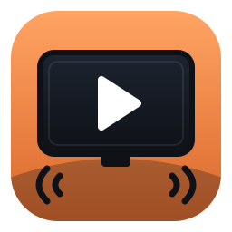
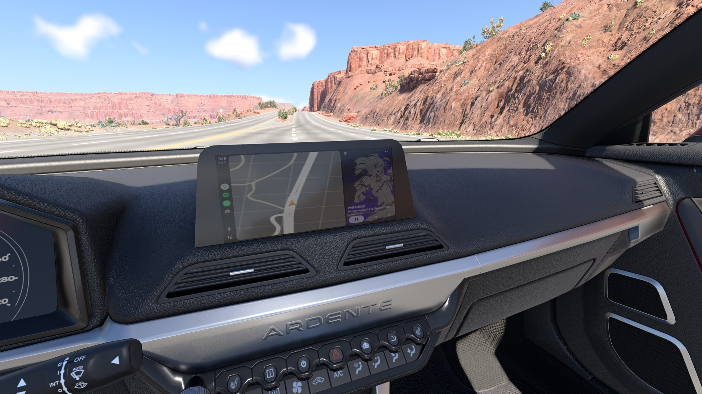
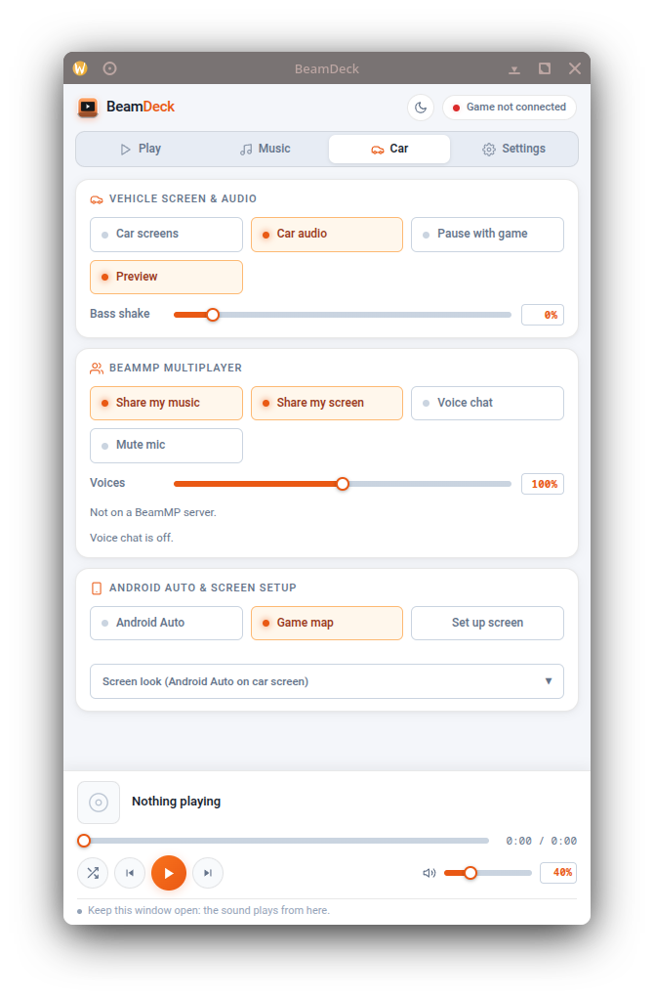

<p align="center">
  
</p>

<h1 align="center">BeamDeck</h1>

<p align="center"><i>Videos, music and Android Auto on the screens and speakers of any car in BeamNG.drive</i></p>

<p align="center">
  
  
  
  
  
</p>

<p align="center">
  <a href="#features"><b>Features</b></a> ·
  <a href="#setup"><b>Setup</b></a> ·
  <a href="#android-auto-setup"><b>Android Auto</b></a> ·
  <a href="#multiplayer-setup-beammp"><b>Multiplayer</b></a> ·
  <a href="#game-controls"><b>Game Controls</b></a> ·
  <a href="#troubleshooting"><b>Troubleshooting</b></a>
</p>

<p align="center">
  
  &nbsp;
  
</p>
<p align="center"><sub>Left: Android Auto from a phone on a car's dash, with the game's map in the Maps pane. Right: the BeamDeck window, Car tab.</sub></p>

BeamDeck has three parts: a small **helper** program, a **control window** (an app-style browser window, where things are picked and where the sound plays) and a **BeamNG mod** (it puts the picture on the car's screens and reports where the car and camera are, so the sound behaves like it comes from the car). An optional **relay** connects players on a BeamMP server.

## Features

### Car Screens

* **Videos:** paste a YouTube (or any yt-dlp supported) link or a file path. Links stream within seconds; **Save** keeps a copy, and the **Files** button opens the saved videos' folder (to delete them, for example).
* **Any screen:** dashboard and infotainment screens of any car that has them, and the windscreen BeamNavigator accessory. Screens are found from each car's own configuration; nothing per car is hard-coded.
* **Now playing card** with title, artist, progress and cover when music is playing.
* **Dims with the headlights**, and Android Auto switches to its night theme.

### Music

* **Local library** (any folders), **Navidrome**, or **App sound**: any program's audio (Spotify, a browser, a music player) picked from a list and played through the car.
* Queue, shuffle, previous / next, and a now-playing bar at the bottom of the window.

### Car Audio

* **Inside the car:** clear, like the door speakers. **Outside:** muffled through the body and quieter with distance.
* **Open doors and broken windows** let the sound out: an opening on the listener's side brings it up to the interior sound (a broken window counts about 84% of an open door), openings on the far side less.
* **Bass shake:** heavy bass shakes the doors, lids and, on big hits, the body. Adjustable, and gated so only real bass moves anything.
* Music stays with the car: getting out and walking (or spectating in multiplayer) leaves it playing in the last car.

### Android Auto

* The phone's **Android Auto on the car's screen**, through Google's Desktop Head Unit. **USB** by default (no developer mode needed), or **Wi-Fi** through the head unit server.
* **Click the dash to tap:** a two-pass set-up (four corners from two camera positions) ties taps to the screen itself, so any camera angle works afterwards.
* **Game map** over the Maps pane: BeamNG's own map at the car's position, following wherever Maps sits in Android Auto's layout (left, right, full screen), day and night. The real map is never shown on the car.
* Its music and navigation voice play through the car, like any other source.
* **Android phones only, no Apple CarPlay:** CarPlay only connects to head units that contain Apple's authentication chip (from Apple's MFi programme), which a PC can't provide, so an iPhone can't connect to a software head unit like this one. iPhone users can still use everything else, including **App sound** for music.

### BeamMP Multiplayer

* **Everyone's car plays their own music**, positioned and muffled the same way, with **Doppler** when cars pass.
* **Shared screens:** each player's car screen (video, Android Auto with the game map, or now playing) shows on their car in the other players' games.
* **Proximity voice chat:** players hear each other from where they are (in a car or on foot), quieter with distance, never muffled. Voice activation or push to talk, with a microphone picker and sensitivity meter.
* Built to stay in sync: reconnects, freezes and song changes rebuild cleanly, and a listener that can't join a stream asks for a fresh one.

### BeamDeck TV

* The TV prop gets a **BeamDeck** configuration: it shows the same as the car screen, and when the camera is nearer the TV than the car, the sound comes from the TV, clear and positioned.

### Light on the Game

* Car screens get pictures only when they change, nearby TVs at most 15 times a second (the 2 nearest within 60 m), and everything heavy (downloads, video, Android Auto capture, audio) runs in the helper and the window, outside the game.

## Setup

### 1. Requirements

| | Linux | Windows |
| :--- | :--- | :--- |
| **Always** | Python 3, `ffmpeg`, `yt-dlp`, a Chromium-based browser (Edge, Chrome, Chromium, Brave or Vivaldi) | Python 3 from python.org (not the Microsoft Store one), `ffmpeg`, `yt-dlp`, Edge or Chrome |
| **App sound** | PipeWire or PulseAudio (`pactl`); `playerctl` for the song title | [VB-CABLE](https://vb-audio.com/Cable/) and NirSoft's [`svcl.exe`](https://www.nirsoft.net/utils/sound_volume_command_line.html) |
| **Android Auto** | An Android phone; `adb` (android-tools), `Xvfb`, `xdotool`, `libc++`, `bsdtar` (for the download), USB access to the phone (e.g. the `android-udev` rules) | An Android phone; the head unit (downloaded by the installer), [Zadig](https://zadig.akeo.ie) once for USB, VB-CABLE + `svcl.exe` for its sound |

BeamNG.drive itself runs natively on Linux or on Windows; the installers find its user folder (also a moved one, from `BeamNG.drive.ini`).

### 2. Install

**Linux**

```sh
git clone <this repository> BeamDeck && cd BeamDeck
./install.sh                                   # helper, window, launcher, icon, user service, BeamNG mod, head unit
systemctl --user enable --now beamdeck         # start the helper now and at login
```

If BeamNG's user folder isn't found: `BEAMNG_USERFOLDER=/path/to/BeamNG.drive/current ./install.sh`.

**Windows** (PowerShell)

```powershell
winget install Python.Python.3.12 Gyan.FFmpeg yt-dlp.yt-dlp
# in the BeamDeck folder:
powershell -ExecutionPolicy Bypass -File install.ps1                # add -AndroidAuto to download the head unit
```

For app sound or Android Auto's sound: install VB-CABLE, and copy `svcl.exe` into `%LOCALAPPDATA%\BeamDeck\app`. Keep the normal speakers or headphones as the default output device.

### 3. First Run

1. Open **BeamDeck** from the app menu or Start menu. Its window opens; **leave it open while playing**, since the sound comes from it.
2. Start BeamNG (restart it if it was already running, so it loads the mod). The dot at the top right of the window turns green with the car's name once the game is connected.
3. **Settings** tab: add music folders, a Navidrome server, or a different browser or BeamNG folder if needed, then **Save**.
4. **Car** tab: turn on **Car screens** (the picture on the car's screens) and **Car audio** (the sound coming from the car instead of plainly from the speakers).
5. **Play** tab: paste a link and press **Play**, or pick music in the **Music** tab.

### 4. TV Prop (optional)

In BeamNG's vehicle selector, pick **TV** and its **BeamDeck** configuration. With **Car screens** on, it shows the same as the car's screen.

## Android Auto Setup

Android phones only; Apple CarPlay isn't possible (see [Android Auto](#android-auto) above).

**USB (default, no developer mode):**

1. On the phone: **Android Auto settings → Previously connected cars → ⋮ → Add new cars to Android Auto** must be on.
2. Plug the phone in by USB and turn on **Car → Android Auto** in the BeamDeck window. The phone switches to car mode and a window titled **Android Auto - Desktop Head Unit** opens (on Windows, keep it visible somewhere on screen; BeamDeck copies its picture).
3. **Windows only, once per PC:** in car mode the phone appears as USB ID `18D1 2D01`, which Windows binds to the wrong driver. Run `adb kill-server`, turn Android Auto on in BeamDeck, then in **Zadig** (Options → List All Devices, untick "Ignore Hubs or Composite Parents") pick the composite device `18D1 2D01` (current driver `usbccgp`), choose **WinUSB** and **Replace Driver**. Unplug, replug, and turn Android Auto off and on. Normal phone USB (file transfer, charging) is unaffected, since that's a different USB ID. To undo it: **Device Manager → Universal Serial Bus devices →** the phone's entry **→ Uninstall device**, tick "Attempt to remove the driver", and replug.
4. **Set up the screen once per car model:** sit in the car, press **Car → Set up screen**, click the screen's four corners in the game, move the camera a little (W/S), and click the four corners again. Clicking the car's screen then taps Android Auto.
5. **Car → Game map** puts BeamNG's map over Google Maps.

**Wi-Fi (optional; the phone and PC on the same network):**

1. Install `adb`: on Linux the `android-tools` package; on Windows `winget install Google.PlatformTools`, then **restart the PC** so BeamDeck finds it.
2. Phone, once: **Settings → About phone →** tap **Build number** 7 times (developer options), then **Developer options → Wireless debugging → Pair device with pairing code**, and on the PC run `adb pair <phone-ip>:<pairing-port>` with the 6-digit code.
3. Phone, once: **Android Auto settings →** tap **Version** 10 times (Android Auto's developer mode).
4. BeamDeck: **Settings → Android Auto → Phone connection: Head unit server**, then **Save**.
5. Each time: turn on Wireless debugging, run `adb connect <phone-ip>:<port>` (the port on the phone's Wireless debugging screen changes each time), start **Android Auto settings → ⋮ → Start head unit server**, then **Car → Android Auto** in BeamDeck.

## Multiplayer Setup (BeamMP)

> [!IMPORTANT]
> Multiplayer needs **your own server**: a BeamMP server you control (the BeamDeck mod goes into its `Resources/Client` folder, so public servers run by others won't have it), and a machine to run the **relay** that every player can reach. Both can be the same machine: a home server, a VPS, or a PC that stays on while you play. Single player needs neither.

### 1. Choose the Server Machine

Any always-on Linux or Windows machine works; the BeamMP server and the relay are both light. The BeamMP server only syncs cars, and the relay passes on about 100 kbit/s per player sharing music, plus video frames while screens are shared and around 20 kbit/s while someone talks.

### 2. Make It Reachable

Every player needs to reach the machine on port **30814** (BeamMP, TCP and UDP) and **47140** (relay, TCP). Pick one:

* **Same home network:** use the machine's LAN address (e.g. `192.168.1.20`). Nothing else to set up.
* **[Tailscale](https://tailscale.com) (recommended for friends elsewhere):** install it on the server and on every player's PC, and share the server with them (or invite them to the tailnet). Use the server's Tailscale address (`100.x.y.z`). No router changes, and nothing is exposed to the internet.
* **Port forwarding:** forward TCP and UDP 30814 and TCP 47140 on the router to the server, and use the public IP. The relay has no password, so anyone who finds the port can listen in; Tailscale or a LAN is safer.

If the server has a firewall, allow those ports (e.g. `sudo ufw allow 30814` and `sudo ufw allow 47140/tcp`).

### 3. Set Up the BeamMP Server

1. Download **BeamMP-Server** for the server's system from its [releases page](https://github.com/BeamMP/BeamMP-Server/releases) into its own folder (e.g. `~/beammp-server`).
2. Get an **AuthKey**: sign in at [keymaster.beammp.com](https://keymaster.beammp.com) and create a key for the server.
3. Run the server once (`./BeamMP-Server` on Linux after `chmod +x BeamMP-Server`, or the `.exe` on Windows). It creates `ServerConfig.toml` and a `Resources` folder; stop it with Ctrl+C.
4. Edit `ServerConfig.toml`, section `[General]`:

   ```toml
   AuthKey = "your-key-from-keymaster"
   Name = "My BeamDeck server"
   Map = "/levels/italy/info.json"      # any map, e.g. /levels/west_coast_usa/info.json
   MaxPlayers = 8
   Port = 30814
   Private = true                       # hidden from the public server list; players use Direct Connect
   ```

5. Start it again and leave it running (for example in `tmux`/`screen` or as a systemd service on Linux).
6. Players join from the BeamMP launcher with **Direct Connect**: the server's address and port 30814.

### 4. Add BeamDeck to the Server

Build the game mod and put it in the server's `Resources/Client` folder:

```sh
./make-beammp-zip.sh                                          # builds beamdeck.zip
./make-beammp-zip.sh myserver:beammp-server/Resources/Client/ # or build and copy it there with scp
```

Nothing goes in `Resources/Server`. Restart the BeamMP server after adding or updating it; players download it when they join.

### 5. Run the Relay

The relay passes music, car screens and voice between players. It is a single Python script using only the standard library, in [`relay/`](relay). Copy the `relay` folder to the server, then either:

```sh
# with Docker (Linux: the docker package or get.docker.com; Windows: Docker Desktop)
cd relay
RELAY_BIND=0.0.0.0 docker compose up -d       # or one address only, e.g. the Tailscale IP: RELAY_BIND=100.x.y.z
```

```sh
# without Docker (needs Python 3); keep it running like the BeamMP server
cd relay
python3 beamdeck-relay.py                    # listens on port 47140; BEAMDECK_RELAY_PORT changes it
```

Check it from a player's PC: opening `http://<server-address>:47140/players` in a browser should show `[]` (nobody sharing yet).

### 6. On Each Player's PC

1. Install BeamDeck (the server only hands out the game mod; the sound is played by the BeamDeck window).
2. **Settings → Multiplayer → Music relay address:** `ws://<server-address>:47140` (just `<server-address>:47140` works too), **Save**, then **Test**: it should say "Connected".
3. **Car** tab: **Share my music**, **Share my screen** and **Voice chat** are on by default. **Settings → Multiplayer** has push to talk, the microphone and the voice sensitivity. Allow the microphone when the window asks, and use headphones for voice chat.
4. Click once anywhere in the BeamDeck window after opening it, then join the server.

**For Windows players:** `./make-friend-zip.sh [output-folder] [ws://server-address:47140]` builds `BeamDeck-Windows.zip` (into `dist/` by default) with the Windows files, the mod, this README and a `RELAY.txt` with the relay address.

## Game Controls

Bound in BeamNG under **Options → Controls** (search "BeamDeck"). All are unbound by default.

| Control | Does |
| :--- | :--- |
| Play / pause, next song, previous song | BeamDeck's player while it plays; otherwise the phone's music through Android Auto |
| Music volume up / down | Everything BeamDeck plays, with an on-screen level |
| Voice volume up / down | Other players' voices |
| Push to talk | Hold to talk (when voice chat is set to push to talk) |
| Mute / unmute mic | Turns the microphone off or on |

## Troubleshooting

| Problem | Fix |
| :--- | :--- |
| "Game not connected" | Restart BeamNG after installing (it loads the mod at start). Check the mod is in `mods/unpacked/beamdeck` in BeamNG's user folder. |
| No sound | The window must stay open; click once inside it. Check **Car audio** and the volume slider. |
| YouTube links stop working | Update yt-dlp: `yt-dlp -U` (or the package manager's update). |
| Android Auto: "Attaching to USB device…" on Windows | The Zadig step above (WinUSB on the `18D1 2D01` composite device). |
| Android Auto picture only fills part of the car screen, or the game map doesn't cover Maps (Windows) | Fixed for Windows display scaling (125 %, 150 %): update BeamDeck. |
| Android Auto: phone doesn't connect | "Add new cars to Android Auto" on the phone; try another cable or port. |
| Multiplayer: others can't hear or see each other | Same relay address for everyone, and **Test** says "Connected". |
| The helper doesn't start (Windows) | `%LOCALAPPDATA%\BeamDeck\helper.log` and `launcher.log` show why. |

## How It Fits Together

| Part | Role |
| :--- | :--- |
| `beamdeck-server.py` | The helper (port 47130): streams and downloads, music library and Navidrome, app sound, Android Auto head unit and capture, and the link to the game |
| `beamdeck-ui.html` | The window: picking what plays, all the audio processing, multiplayer sending and receiving, voice chat |
| `beamdeck-launch.py` | Starts the helper if needed and opens the window in its own browser profile |
| `mod/` | The BeamNG mod: game script, car-screen script and page, TV prop configuration, game controls |
| `relay/` | The multiplayer relay (`beamdeck-relay.py`) and its compose file |
| `install.sh`, `install.ps1` | Installers for Linux and Windows |
| `make-beammp-zip.sh`, `make-friend-zip.sh` | Build the server's mod package and the Windows package for other players |

The full design, the reasoning behind it and the problems solved along the way are in [**docs/beamdeck.md**](docs/beamdeck.md). Google's Desktop Head Unit and NirSoft's `svcl.exe` are not included; the installers download the head unit from Google, and `svcl.exe` comes from NirSoft's site.

## About This Project

AI was used to handle troubleshooting and bug fixes in this project, as I am still learning Python.
