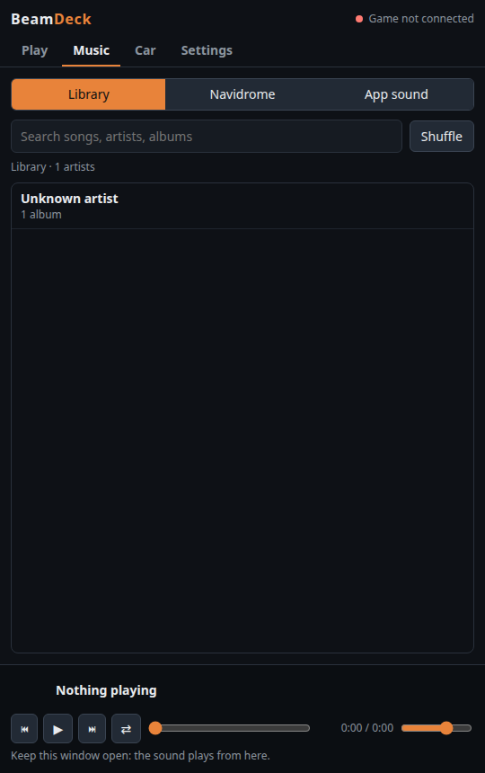

# BeamDeck: Videos, Music and Android Auto in BeamNG

<p align="center"></p>

Puts things on a car's own dash and GPS screens in **BeamNG.drive**:

* **Any video**: YouTube, anything else `yt-dlp` supports, or a local file. Built for Bad Apple on a Vivace's centre screen.
* **Music**: a local music library, a Navidrome server, or **any app's sound** (Spotify, a music player, a browser…) picked from a dropdown, with the song's cover, title and artist on the car screen.
* **Android Auto** from an Android phone over a USB cable, like a real car (no developer mode, no Bluetooth), tapped by clicking the screen in the game, optionally with **BeamNG's own GPS map** drawn over Google Maps.

The sound comes "from the car" (clear inside, muffled outside), heavy bass shakes the doors and body, and the screen dims with the headlights. The source is in the [repository root](..).

```
 BeamDeck window (Edge app, 127.0.0.1:47130)            beamdeck-server.py                       BeamNG (native Linux)
 ┌───────────────────────────────┐  HTTP + WebSocket   ┌──────────────────────────┐   UDP 47131/47132  ┌───────────────────────────────┐
 │ link · Play / Save · toggles  │◄───────────────────►│ yt-dlp stream proxy,     │◄──────────────────►│ GE extension "beamdeck"        │
 │ <audio> = master clock        │  camera, bass, taps │ downloads, ffmpeg        │  state · camera ·  │  camera/car info, clicks → taps │
 │ Web Audio: car EQ, muffle,    │  AA frames + sound  │ screen copies ───────────┼──files────────────►│  frames → queueJSUITexture     │
 │ pan, bass analyser            │                     │ Android Auto:            │  TCP 47133 frames  │ vehicle ext "beamdeckScreens"  │
 └───────────────────────────────┘                     │  Xvfb :87 + Google DHU   │───────────────────►│  dash pages, map, dim, shake   │
                                    Pixel ──adb──────► │  x11grab · xdotool · sink│                    └───────────────────────────────┘
                                                       └──────────────────────────┘
```

## 1. Using It

1. Open **BeamDeck** from the app launcher (an Edge `--app` window). Keep it open: **the sound plays from this window**, and closing it turns Android Auto off after 5 s (F5 doesn't).
2. Paste a link and press **Play** (streams, starts in a couple of seconds) or **Save** (downloads first; also used automatically for local files and sites with no streamable format).
3. In BeamNG the dot at the top of the window turns green (`vivace · 1 screen · inside`). Nothing to open in the game; the mod starts with it.

| Control | Does |
| :--- | :--- |
| **Car screens** | Puts BeamDeck on the car's dash / GPS screens. Off puts the gauges back |
| **Car audio** | Inside: full range with a little low-end, like door speakers. Outside: clearer and louder the more doors, trunk or windows are open or broken on your side; closed, it's low-passed (900 Hz falling to 250 Hz with distance), quieter with distance, panned to the car. Android Auto's sound goes through it too |
| **Pause with game** | Pauses the video while BeamNG is paused |
| **Preview** | Shows the video (or Android Auto, tappable) in the window too |
| **Bass shake** (0–2) | Heavy bass makes the doors buzz (24 Hz, left and right doors opposite) and the body shake (9 Hz) |
| **Files** | Opens `~/.cache/beamdeck` (saved videos, named `<title> [<key>].webm`) to delete them |
| **Android Auto** | The phone's Android Auto on the car screen (see 2) |
| **Game map** | BeamNG's GPS map wherever Android Auto is showing Google Maps (left pane, right pane or full screen); hidden while no map is showing |
| **Set up screen** | Click the car screen's four corners, move the camera a little (W/S), click them again; once per car model. Clicks on the screen then tap Android Auto from any camera angle |
| **Screen look** | Brightness, contrast, colour, gamma and tint of Android Auto on the car screen, on top of the page's own toning down |

Headlights on (`lights_state` > 0) dims the screen 45 % and switches Android Auto to its night theme.

## 2. Music

The **Music** tab has three sources; whatever plays goes through the same car audio and bass shake, and when no video or Android Auto is on the car screen it shows a **now-playing card** (cover, title, artist · album, progress).

| Source | How |
| :--- | :--- |
| **Library** | Folders from Settings, scanned with `ffprobe` (4 at a time, cached in `library.json` by path + mtime). Browse artist → album → songs or search; covers are the embedded art or a `cover`/`folder`/`front` image beside the files. Edge plays MP3, FLAC, Ogg/Opus, M4A/AAC and WAV directly. |
| **Navidrome** | The Subsonic API with token auth (`md5(password + salt)`); the helper keeps the password and proxies browsing, covers and `stream?format=raw` (Range passed through, so seeking works). **Test** in Settings checks it. |
| **App sound** | A dropdown of every app making sound. Linux: the app's streams move to a null sink `beamdeck_car` (re-moved every second, since apps open a new stream per song) whose monitor is captured and played through the window ('B' + 20 ms PCM); Off moves them back to the default output. BeamDeck's own window (its browser profile's process tree, from `window.pid`) and BeamNG are left out so nothing loops. Now playing comes from `playerctl` (MPRIS). |

Queue: clicking a song plays its album or search results from there; ⏮ ⏭, **Shuffle** (keeps the chosen song first). Starting your own music or a video turns app sound off, and picking an app pauses the window's own player: one source in the car at a time.

The cover reaches the car screen over the game's TCP channel (type byte `C` + base64 JPEG, 256 px, made with ffmpeg); title, artist, position and paused ride in the 5 Hz UDP state (`np`).

## 3. Android Auto

* **Connection (Settings → Android Auto):** **USB cable** by default: the head unit runs `--usb`, the phone switches to Android Open Accessory mode (`18d1:2d00`/`2d01`) exactly as it does for a car, and Android Auto starts by itself, so **its developer mode and head unit server aren't needed** (tested with developer mode off). The alternative is the developer **head unit server** over adb (`--adb` + `adb forward tcp:5277`), which also works over Wi-Fi adb.

* **Head unit:** Google's own **Desktop Head Unit 2.1** (Android SDK `extras;google;auto`, downloaded by `install.sh` and checked against its SHA-1), running on a hidden `Xvfb :87` at 1280×720. It needs `libc++`.
* **Head unit server route (optional):** USB debugging or Wireless debugging, Android Auto's developer mode (tap **Version** 10 times) → **⋮ → Start head unit server**. After a failed session the server can stop listening while its notification still says "running": stop and start it again.
* **First connection:** Android Auto → **Previously connected cars → ⋮ → Add new cars to Android Auto** must be on, otherwise the phone logs `Triggering FRX: car connection is not allowed` / `CAR.AUTH: Call from UID … is not allowed` and drops the head unit.
* **Picture:** `ffmpeg -f x11grab` at 10 fps, scaled to 960×540 with the Screen look `eq`, as JPEGs. The window gets them over its WebSocket (`'J'` + JPEG); the game reads them over plain TCP (47133, 8 hex digits of length + base64) and hands each one to the screen page as a data URL with `veh:queueJSUITexture(tag, "btFrame(…)")`, the same call the game uses to feed its own GPS screens.
* **Taps:** set-up is two passes of the four corners from two camera positions; each corner is triangulated from its two rays (closest point between them), giving the screen's real corners in the car's ref-node frame (`settings/beamdeck_screens.json`, `v: 3`). A click (`im.IsMouseClicked(0)`, the camera position from `core_camera.getPosition()` and `getCameraMouseRay()`'s direction) is intersected with that plane and mapped to the picture with a homography, so it works from any camera angle or seat position. Raycast hits (`cameraMouseRayCast`) don't work for this: they land on other geometry. A ring flashes on the screen where each tap lands; the helper clicks `(u, v)` with `xdotool`.
* **Sound:** while Android Auto is on, the helper loads a null sink `beamdeck_aa`, moves the DHU's ALSA stream (`node.name` `alsa_playback.desktop-head-unit`, no process id) onto it, and streams its monitor as 48 kHz s16le to the window (`'A'` + 20 ms), which plays it through the car effect.
* **Where Maps is:** twice a second the helper grabs the head unit's screen in grey and looks for Maps' **Search bar**: an even run of 200–450 px (white by day, very dark grey ≈ 18 at night, pixel-to-pixel steps ≤ 4) on a row just above its text (41–47) and one just below (83–89); the text sits higher at night. If the map is lost for a moment (day/night switch, animations) the game map stays where it was for 2 s instead of uncovering the real map. Its middle says which pane (left x 80–850, right x 860–1270); the black gap at x 851–858 tells the split view from full-screen Maps (x 80–1270). App icons are narrower than 200 px, app title bars wider than 450, so the apps menu or an app on the left reads as "map on the right". Taps on the covered pane are dropped.
* **Game map:** the car page loads the game's `navigator-class.js` and `navigator.css` into a box over that pane; the vehicle extension asks `ui_uinavi.requestVehicleDashboardMap` for the map data and sends position, heading and speed 15 times a second with the same formula as the game's `beamNavigator`.

### BeamDeck TV

The TV prop gets a **BeamDeck** configuration (spawn menu → TV → BeamDeck, or TV type "25 Inch CRT TV (BeamDeck)"): the stock 25" CRT with a screen panel on its glass that shows the same as your car screen (video, Android Auto, now playing) while **Car screens** is on, and "no signal" otherwise. When you're nearer the TV than your car (and not inside the car), the sound comes from the TV: clear (never muffled), quieter with distance, panned to it.

* **Files** (mod `vehicles/tv/`, added next to the stock TV without changing it): `beamdeck_tv.jbeam` (the stock part copied, plus the `BeamDeckTVscreen` flexbody on `tv_front` and a `beamdeckTV` controller), `beamdeck_tv_screen.dae` (one 45.2 × 36 cm rectangle at y = −21.75 cm, out to the glass edges, tucked behind the frame lips), `beamdeck_tv.materials.json` (emissive `@beamdeck_tv`), `beamdeck.pc` + `info_beamdeck.json`. `lua/vehicle/controller/beamdeckTV.lua` creates the 640×510 page (`ui/beamdeck/tv.html`) and tells GE (`beamdeck.onTV`); the vehicle extension finds it like any car screen.
* **Kept cheap:** only your own TVs (BeamMP), only the **2 nearest within 60 m** are driven (re-checked every 0.5 s), Android Auto / video pictures go to them at most **15 a second**, and a TV is never treated as your music car.

## 3b. Multiplayer (BeamMP): Everyone's Car Plays Their Own Music

On a BeamMP server, each player's car plays that player's music, and you hear the others' cars through the same car effect: muffled from outside, louder close up, panned to where the car is, with **Doppler** (343 m/s; faster and higher approaching, lower driving away, 0.8–1.25×). Everyone picks their own music; any source works (links, library, Navidrome, app sound, Android Auto), because what's shared is the car's mix **before** the car effects (a `MediaStreamDestination` fed by the player and the PCM sources). Walking around (BeamNG's walking mode is a "unicycle" vehicle) never makes a person a sound source: the music stays in the car you got out of, for you and for others.

```
 your BeamDeck ──MediaRecorder WebM/Opus 96 kbps, 250 ms pieces──► relay (/pub?player=you)
 relay (/sub) ──[name length][name][WebM]──► every BeamDeck ──MediaSource <audio> per player──► distance · pan · Doppler
```

* **Relay** (`relay/`): `beamdeck-relay.py`, standard library only, in a `python:3.12-alpine` container. On a home server it can live in e.g. `~/beamdeck-relay`, bound to a Tailscale address only (`RELAY_BIND=100.x.y.z docker compose up -d`; port 47140). Players set **Settings → Multiplayer → Music relay address** to `ws://<server>:47140` (**Test** lists who's sharing). **Car → Share my music** turns sending on or off (on by default; only while on a BeamMP server).
* **Who is where:** GE uses BeamMP's `MPConfig.getNickname()` and `MPVehicleGE.getPlayers()` / `getVehicles()`; each player's `activeVehicleID` is the car they're in (if they walk or spectate, their last car). Looked up by name 20 times a second, so a re-synced or respawned car (new game ID) keeps its music.
* **Staying in sync:** it's a live stream, not a file. A listener more than 3 s behind (after a freeze) jumps to the live point; every new stream from a player (reconnect, restart) gets a new **generation** from the relay (`{"type":"start","gen":n}` before its header), and listeners rebuild that player cleanly; a broken player sends `{"type":"resync"}` and gets the header again; an old connection that lost to a newer one is ignored. Changing songs needs no sync: it's all one continuous stream.
* **Never on the wrong car or twice:** your window ignores the stream with your own name; each player's music is tied to a car **they own** (spectating someone keeps it in your last own car, and "inside" only counts in your own car), so two songs never come from one car and your screens and bass shake never act on someone else's car; a reconnecting player's old stream is dropped by the relay; and with two BeamDeck windows open on one PC only the **newest** plays Android Auto / app sound and the multiplayer music (the helper tells older ones to step back, and hands back when the newest closes).
* **Shared screens:** with **Car → Share my screen** (on by default), what's on your car screen also shows on **your car** in the other players' games: Android Auto or the video as 480×270 JPEG frames (~6/s, drawn from the window's preview / Android Auto canvas on each game update so a hidden window isn't throttled), or the now-playing card (title, artist, position once a second, cover as a 256 px JPEG when it changes). Only while your own Car screens are on. It goes to the relay as `/pub?player=…&kind=screen` (`F` frame, `N` info JSON, `C` cover); the relay keeps each player's latest of each for late joiners and says `screengone` when they stop. Their window passes it to their helper (`R` + name + type + data), the helper to their game (TCP kind `R`), and GE switches that player's car screens to BeamDeck (loading the vehicle extension on the remote car), pushes the picture with `queueJSUITexture`, and puts them back 6 s after the last update. **The map mirrors the sender:** with your Game map on, viewers get the game map over your Android Auto's Maps pane, drawn at your car's position in their game; with it off, they see your real map.
* **Doppler:** GE sends each car's speed towards you (`(car velocity − camera velocity) · direction`, the camera's from its movement between updates; jumps over 150 m/s ignored) and the window sets `playbackRate` with `preservesPitch = false`.
* **Proximity voice chat** (**Car → Voice chat**, on by default; **Mute mic** next to it): the mic (`getUserMedia` with echo cancellation, noise suppression and auto gain) goes through `MediaStreamTrackProcessor` into a WebCodecs `AudioEncoder` (Opus, 32 kbps, 20 ms packets, ~50 bytes each) and to the relay as `/pub?player=…&kind=voice`; nothing is kept there, packets are passed on as kind `V` (`[channels][Opus]`). Each listener decodes with an `AudioDecoder` per player and schedules the 20 ms buffers ~80 ms ahead (drops back if delay builds over 0.4 s), so it's far quicker than the music path. GE sends where each player is (their own active vehicle, car **or** on foot; when spectating, their car). Voices are **never muffled** by cars or doors: just distance (full within 2 m, half at 12 m, gone by 90 m) and pan. **Settings → Multiplayer:** voice activation (with a sensitivity slider and level meter) or **push to talk**, and the microphone. Only sends while you talk. Use headphones (echo cancellation can't always remove the others' voices from your speakers).
* **Game controls** (`lua/ge/extensions/core/input/actions/beamdeck.json`, in BeamNG **Options → Controls**, search "BeamDeck", unbound by default): play / pause, next / previous song (BeamDeck's own player: videos, links, library, Navidrome; when that isn't playing and Android Auto is on, they go to the phone as `keycode media_play_pause` / `media_next` / `media_previous` on the head unit console, like steering-wheel buttons), push to talk, mute / unmute mic, music volume up / down (the window's volume: music, videos, Android Auto and other players' music), voice volume up / down. GE sends `{"cmd": …}` to the helper over UDP, the helper passes it to the window (`gamecmd`), and the window answers with a short in-game message (`toast` → TCP kind `T` → `ui_message`). The window's volume is remembered now.
* **On the BeamMP server:** only `Resources/Client/beamdeck.zip` (the game mod, built by `make-beammp-zip.sh [server:path/]`); nothing in `Resources/Server`. Rebuild and copy it after changing the mod. Players still need BeamDeck installed (it plays the sound) and the relay address in Settings.

### Playing with Friends

The BeamMP server only hands out the **game mod** (`Resources/Client/beamdeck.zip`): the scripts that track cars, positions and screens. The sound is played by the **BeamDeck app** (helper + window), which a game mod can't contain, so each friend installs it once. Without it nothing breaks; they just don't hear anyone's car music and theirs isn't shared.

* **Make the package:** `make-friend-zip.sh [folder] [relay]` builds `BeamDeck-Windows.zip` (into `dist/` by default): the Windows files, the mod, and the README and a `RELAY.txt` with the relay address (from the BeamDeck settings, or the second argument). Send it to them.
* **Their side, once:** `winget install Python.Python.3.12 Gyan.FFmpeg yt-dlp.yt-dlp`; unzip; `powershell -ExecutionPolicy Bypass -File install.ps1`; be on the same Tailscale network as the server; BeamDeck → **Settings → Multiplayer** → relay address → **Test** ("Connected").
* **Their side, every time:** open BeamDeck first and leave the window open (click it once so it may play sound), join the server (BeamMP downloads or updates the mod), play their own music in BeamDeck. **Car → Share my music** keeps theirs private.
* **Android Auto** works for them too with an Android phone and a USB cable (no developer mode); the README's Android Auto Setup covers it: install with `-AndroidAuto`, the one-time **Zadig → WinUSB** swap for the phone's car-mode ID 18D1 2D01, "Add new cars to Android Auto", Set up screen, and keeping the head unit window visible. Its sound needs VB-CABLE + `svcl.exe`. App sound and Navidrome are optional extras.

## 4. Why It's Built This Way

* **Open doors and broken glass:** every 0.5 s the vehicle extension adds up the openings per side (L/R/F/B/T, 0–1): a door, trunk or tailgate whose latch (`<name>_notAttached` from `advancedCouplerControl`) is open or gone, 0.35, or a shattered pane, 0.28 (about 84 % of a door). Glass shatters by swapping to its broken look through a **deform group** (`doorglass_L_break`, `backlight_break` = rear window), so any `beamstate.deformGroupDamage` on a glass group counts as gone (a windscreen only cracks: up to 0.3); broken glass break groups (`beamstate.brokenBreakGroups`) count too. GE weights them by where the camera is (your side fully, the far side 45 %) into `openness`; outside the car the window multiplies it by 3, so one opening on your side gives the **interior sound** (≈ 11 kHz, full volume, fading only with distance), and blends from muffled on a log scale. BeamNG cars have no roll-down windows, so a broken window stands in for an open one. What's detected shows on `/debug` (`car_shake.openings`).

* **BeamNG's UI can't load from the network.** Its CEF cancels every request the UI or a car screen makes to `http://127.0.0.1`/`localhost` (`OnBeforeResourceLoad | Resource cancel URL=…` in `beamng.log`), even though the CSP allows it. **WebSockets are blocked too**: a car page "connected" only in the sense that Chromium opened a preconnect socket that never sent a request. So:
  * the controls live outside the game (which also fixes **Ctrl+V**, which the game takes for its own bindings);
  * the game talks to the helper with LuaSocket (UDP and TCP aren't filtered);
  * videos reach the car screens as a **video-only copy** (≤480p VP9) that the helper writes into BeamNG's user folder (`beamdeck_media/`; not the mod folder, because BeamMP switches local mods off in multiplayer), loaded through the game's own file system as a blob so seeking works. The newest 8 are kept.
* **CEF has no H.264 or AAC**, so everything is VP9/AV1 + Opus/Vorbis WebM. YouTube offers that as separate DASH streams; the helper proxies them in 8 MB ranges.
* **The window's `<audio>` is the master clock.** The helper keeps the position and sends it to the game 5 times a second; the screens seek if they drift more than 0.35 s.
* **Car screens:** found from the vehicle's jbeam controllers (gauges with `materialName` + `htmlPath`, and `beamNavigator` GPS screens). `obj:createWebView` on an existing screen is **ignored**, so the extension navigates the existing page (`queueWebViewJS(tag, "location.replace(…)")`) and back.
* **Bass shake:** an `AnalyserNode` averages 30–110 Hz (loud bass only, plus a punch term); the level goes window → helper → UDP → GE → vehicle, which applies `obj:applyForceVector` every physics step on up to 64 door nodes and 24 body nodes, scaled by node weight. It drops to 0 when playback stalls.

## 5. Install and Settings

Nothing personal is built in: settings live in a per-user `config.json` (`~/.config/beamdeck/` on Linux, `%APPDATA%\BeamDeck\` on Windows) and are edited in the **Settings** tab: music folders (Rescan), Navidrome address / user / password (the file is `0600`; the password is never sent back to the window), BeamNG's user folder (empty = detected: native, Proton, or `%LOCALAPPDATA%`; the `current` folder or the newest version) and the browser for the window (empty = Edge, Chrome, Chromium, Brave or Vivaldi, whichever is installed).

**Linux:** `./install.sh`, then `systemctl --user enable --now beamdeck`. Needs `python3`, `ffmpeg`, `yt-dlp` and a Chromium browser; app sound and Android Auto need `pactl` (PipeWire/PulseAudio); Android Auto needs `android-tools`, `xorg-server-xvfb`, `xdotool`, `libc++`; app now playing needs `playerctl`. BeamNG loads the mod at start; in a running game `extensions.reload("beamdeck")` and **Ctrl+R**.

**Windows:** `powershell -ExecutionPolicy Bypass -File tools\beamdeck\install.ps1` (add `-AndroidAuto` to fetch Google's Windows head unit, SHA-1 checked). Needs Python 3, `ffmpeg` and `yt-dlp` (`winget install Python.Python.3.12 Gyan.FFmpeg yt-dlp.yt-dlp`). It adds a **BeamDeck** Start-menu entry that starts the helper (`pythonw`, no console) and opens the window.

| Port | What |
| :--- | :--- |
| `127.0.0.1:47130` TCP | Helper: the window, API, stream proxies, WebSocket, `/debug` |
| `127.0.0.1:47131` UDP | Game listens: screen state, now playing, bass, Android Auto / game map / set-up flags |
| `127.0.0.1:47132` UDP | Helper listens: camera / car / headlights / shake info, taps |
| `127.0.0.1:47133` TCP | To the game: Android Auto frames (`F`) and covers (`C`) |

## 6. Windows

The same helper, window and mod run on Windows, and the Linux-only pieces have Windows versions, chosen automatically. **Tested on Windows 11 (BeamNG 0.40.4, Pixel 7a):** install, launcher, YouTube, the music library, car screens, Android Auto over USB with taps on the car screen. **Not yet:** app sound and Android Auto's sound (need VB-CABLE + `svcl.exe`), game-map pane detection on a real drive.

| Piece | Linux | Windows |
| :--- | :--- | :--- |
| Helper in the background | systemd user service | started by the launcher (`pythonw`); output in `%LOCALAPPDATA%\BeamDeck\helper.log`, launcher starts in `launcher.log`, errors as message boxes |
| Child tools (ffmpeg, yt-dlp…) | normal | `CREATE_NO_WINDOW` (no console flashes) and UTF-8 pipes (titles were garbled as cp1252) |
| BeamNG user folder | detected | detected, **`userFolder` in `%LOCALAPPDATA%\BeamNG\BeamNG.drive.ini` first** (a folder moved in BeamNG's launcher; otherwise an old version folder gets picked) |
| Python | system | python.org Python; the installer skips the Microsoft Store one (its AppData redirection hides `%LOCALAPPDATA%\BeamDeck`) |
| App sound | PipeWire null sink + `pactl` | **VB-CABLE** + NirSoft **`svcl.exe`** in `%LOCALAPPDATA%\BeamDeck\app` (optional: without it, no app sound and Android Auto plays silently). `/SetAppDefault "CABLE Input" all <exe>`, captured with `ffmpeg -f dshow`. The window's own browser is left out of the list |
| App now playing | `playerctl` | Windows media controls (`pip install winrt-runtime winrt-Windows.Media.Control winrt-Windows.Foundation`; optional) |
| Android Auto picture | hidden `Xvfb :87` + `x11grab` | the head unit's own window by title with `gdigrab`, retried until it exists; it must stay **visible** (another monitor is fine; focus doesn't matter) |
| Android Auto taps | `xdotool` on the hidden display | the head unit console's **`tap x y`** on its stdin (its SDL window ignores posted mouse messages) |
| Android Auto USB | works as is | **once per PC:** in car mode the phone is `18D1:2D01`, which Windows binds as a **USB Composite Device** (`usbccgp`), so the head unit finds it but "Attaching to USB device…" fails (`Couldn't find/access compatible USB device`). Fix: `adb kill-server`, start Android Auto (the phone only stays in car mode while the head unit retries), **Zadig → Options → List All Devices**, untick *Ignore Hubs or Composite Parents*, pick the **composite** `18D1 2D01` entry (no "(Interface …)"), **WinUSB → Replace Driver**, replug. Phone-maker drivers (Samsung, spacedesk) can also grab it; same fix. Normal USB/adb is untouched (other ID). Tested on a Pixel 7a and a Pixel 10 Pro |
| Android Auto sound | null sink `beamdeck_aa` | the same VB-CABLE (shared with app sound) |

* Keep **yt-dlp** up to date (`yt-dlp -U`, or your package manager): an old one gets **403 Forbidden** from YouTube.
* The Windows window is raised when BeamDeck is launched again (the running Edge otherwise opens new windows behind everything).

## 7. Gotchas Found Building It

1. **Simple-menu app picker:** BeamNG 0.40's simplified UI hides UI apps with `"interactive": "required"` (the first, in-game version of BeamDeck didn't show).
2. **Cache and BeamNG folder are on different filesystems**, so files for the game are written next to their final name, then renamed.
3. **WebSocket accept GUID** is `258EAFA5-E914-47DA-95CA-C5AB0DC85B11`; a wrong one passes a hand-rolled client but every browser drops the connection.
4. GE Lua: `os.clock()` is CPU time; use `os.clockhp()`.
5. **The DHU quits on end of input**: it reads console commands (`day`, `night`, `dpad …`) from stdin, so it needs a pipe that stays open. After a failed session the phone's head unit server can stop listening while its notification still says "running": stop and start it again.
6. **Car pages don't run `eval`**, so the page is one file with its script inline.
7. Browsers keep a page's audio asleep until it's clicked; the window wakes it on any click.
8. **Shared music silent until a click (Linux):** Android Auto's sound could create the window's `AudioContext` before any click, and Chromium keeps it `suspended`, so the MediaRecorder stream others hear was silence until you clicked (toggling Share "fixed" it). The launcher now passes `--autoplay-policy=no-user-gesture-required` (BeamDeck's own browser profile only), sharing waits for a running context and starts a fresh stream when it starts running, and a listener whose resyncs keep failing asks the sender (through the relay, `{"type":"restart"}`) for a fresh stream. Voice chat has its own connection and isn't touched by any of this.
9. **1 fps after a config change (fixed):** after a change in the config menu, a car's `partConfig` is the whole configuration serialized as one string (tens to hundreds of KB) instead of a `.pc` path. BeamDeck matched `([^/]+)%.pc$` on it 20 times a second for the calibration key; on text without slashes that pattern is quadratic (0.6 s per call at 10 KB, ~1 min at 100 KB), so the game crawled for everyone with the mod. The key is now worked out once per car (cached by ID, cleared on respawn) with a length check, edited cars use `<model>/custom` and fall back to the model's calibration. Found with a one-off LuaJIT `jit.profile` script (not shipped: starting it on a running game at 1 ms sampling froze the game once, so it's kept out of the mod); `perf` alone only showed time in the string library.
